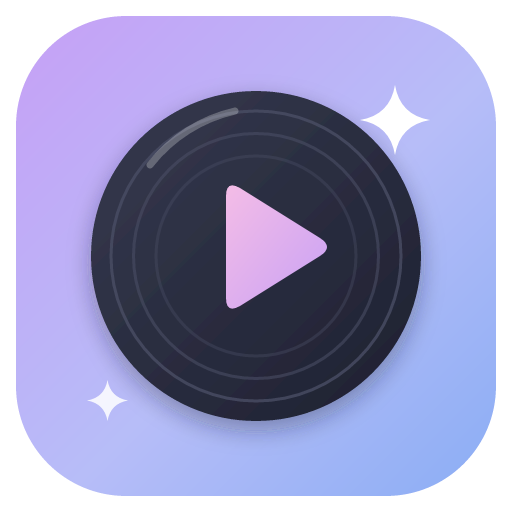

<div align="center">



# ✨ TesuPlayer

**Музыкальный плеер для своей музыки, YouTube и Twitch — на компьютере и Android. Без чужих серверов: компьютер сам становится сервером для телефона.**

<p>
  
  
  
  
</p>


<br/><br/>

[📦 Релизы](https://github.com/tesutavt/feishin/releases) · [🐛 Сообщить об ошибке](https://github.com/tesutavt/feishin/issues) · [💡 Предложить идею](https://github.com/tesutavt/feishin/issues) · [🎵 Оригинал — Feishin](https://github.com/jeffvli/feishin)

</div>


> [!NOTE]
> TesuPlayer — **форк [Feishin](https://github.com/jeffvli/feishin)** от [jeffvli](https://github.com/jeffvli) и его контрибьюторов.
> Интерфейс плеера — их работа; здесь добавлены встроенная библиотека и свой сервер, YouTube, Twitch, нативное Android-приложение и своё оформление.
> Лицензия та же — [GPL-3.0](LICENSE).

<details>
<summary><b>📑 Содержание</b></summary>

- [О проекте](#-о-проекте)
- [Скриншоты](#-скриншоты)
- [Возможности](#-возможности)
- [Технологии](#%EF%B8%8F-технологии)
- [Установка и запуск](#-установка-и-запуск)
- [Структура проекта](#-структура-проекта)
- [Планы](#%EF%B8%8F-планы)
- [Автор](#-автор)

</details>

## 📖 О проекте

TesuPlayer — обычный музыкальный плеер: открыл, выбрал папку с музыкой, слушаешь. Никаких серверов настраивать не нужно.

Если хочется слушать ту же музыку с телефона или другого компьютера, в настройках включается **«Доступ с других устройств»**: TesuPlayer на ПК становится сервером для ваших устройств. Плейлисты, избранное и прослушивания хранятся на ПК и одинаковы везде, а в разделе **«Где играет»** видно, на каком устройстве что играет, и им можно управлять.

Отдельно — **YouTube и Twitch**: поиск в одной строке, стримы как радио, а песни с YouTube можно скачать именно как музыку (аудиофайл с названием, исполнителем и обложкой). Всё работает из коробки: [yt-dlp](https://github.com/yt-dlp/yt-dlp) уже лежит в установщике и сам обновляется.

## 📸 Скриншоты

<!-- Скриншоты десктопного интерфейса из Feishin; свои пока не сделаны -->
<p align="center">
  
  &nbsp;
  
</p>

## 🌟 Возможности

**Компьютер (Windows / Linux / macOS)**
- ✅ Своя библиотека: папки с музыкой сканируются сами (по умолчанию «Музыка»), теги и обложки из файлов
- ✅ Всё из Feishin: альбомы, исполнители, жанры, плейлисты, тексты песен, эквалайзер, визуализатор, Discord RPC
- ✅ **YouTube + Twitch** в одной строке поиска; Twitch-канал сразу показывает, в эфире ли он и что стримит
- ✅ **«Скачать»** с YouTube — m4a-аудио с тегами и обложкой в «Музыка/TesuPlayer/YouTube», сразу в библиотеке
- ✅ Кнопка **«● В эфир»** — если стрим подвис, вернуться к прямому эфиру
- ✅ **Избранное** (каналы и видео) хранится в «Радиостанциях» и видно на всех устройствах
- ✅ **Свой сервер**: доступ с телефона и других ПК по логину и паролю (совместим с Subsonic-клиентами)
- ✅ **«Где играет»**: устройства, что на них играет, пауза/переключение и «Слушать здесь»
- ✅ Можно слушать библиотеку другого компьютера с TesuPlayer

**Android (Kotlin + Jetpack Compose)**
- ✅ Музыка с самого телефона — сразу, без входа и интернета
- ✅ Библиотека своего ПК: альбомы, плейлисты, ★ избранное, поиск; прослушивания синхронизируются
- ✅ Поиск по телефону, компьютеру или YouTube + Twitch
- ✅ Плеер Media3: кнопки в уведомлении и на экране блокировки, гарнитура, очередь, перемешивание, повтор
- ✅ YouTube «Скачать как музыку» → «Музыка/TesuPlayer»; треки с ПК — для офлайна
- ✅ «Где играет» и «Слушать здесь», «Вернуться в эфир» для Twitch
- ✅ «Поделиться» ссылкой YouTube/Twitch из любого приложения → сразу играет

## 🛠️ Технологии

<p align="left">
  
</p>

## 🚀 Установка и запуск

### Готовые сборки

Скачайте из [Релизов](https://github.com/tesutavt/feishin/releases): `TesuPlayer-*-win-x64.exe` для Windows или `TesuPlayer-*.apk` для Android (разрешите установку из неизвестных источников).

### Телефон + компьютер

1. На ПК: **Настройки → Моя музыка → Доступ с других устройств** — включить, запомнить логин, пароль и адрес.
2. На телефоне: **Настройки → Мой компьютер** — ввести адрес, логин и пароль.
3. Вне дома: пробросьте порт (по умолчанию `45173`) на роутере или используйте Tailscale / ZeroTier.

### Компьютер из исходников

**Требования:** Node.js 22+, pnpm 11

```bash
git clone https://github.com/tesutavt/feishin.git
cd TesuPlayer
pnpm install
pnpm dev                 # режим разработки
pnpm run package:win     # установщик Windows → dist/ (yt-dlp кладётся внутрь автоматически)
```

### Android из исходников

**Требования:** JDK 17+, Android SDK 35 (путь — в `android/local.properties`: `sdk.dir=...`)

```bash
cd android
./gradlew assembleRelease   # → app/build/outputs/apk/release/app-release.apk
```

Иконки всех размеров (десктоп и Android) генерируются из `media/tesuplayer.svg`: `node scripts/generate-icons.mjs`.

## 📂 Структура проекта

```
TesuPlayer/
├── src/
│   ├── main/features/core/
│   │   ├── local-library/   # сканер музыки + встроенный сервер (Subsonic API, устройства, синхронизация)
│   │   └── streams/         # YouTube / Twitch через yt-dlp, скачивание аудио
│   ├── renderer/features/
│   │   ├── local-library/   # «Моя музыка» в настройках, подключение к другому ПК
│   │   ├── streams/         # страница «YouTube / Twitch»
│   │   └── devices/         # «Где играет»
│   └── shared/              # общие типы
├── android/                 # Android-приложение (Kotlin, Compose, Media3, youtubedl-android)
├── media/tesuplayer.svg     # исходник иконки
├── scripts/                 # generate-icons.mjs, fetch-ytdlp.mjs
└── README.md
```

## 🗺️ Планы

- [x] Своя библиотека без серверов
- [x] YouTube и Twitch из коробки, скачивание как музыки
- [x] Свой сервер, синхронизация и «Где играет»
- [x] Android-приложение с музыкой телефона и офлайном
- [ ] Свои скриншоты
- [ ] Исполнители и жанры в Android-версии
- [ ] Подпись релизов своим ключом

## 💜 Автор

<table>
  <tr>
    <td align="center">
      <a href="https://github.com/tesutavt">
        <br/>
        <b>Tesuta</b>
      </a><br/>
      <sub>втубер · программист</sub>
    </td>
    <td align="center">
      <a href="https://github.com/jeffvli/feishin">
        <br/>
        <b>jeffvli</b>
      </a><br/>
      <sub>автор оригинального Feishin</sub>
    </td>
  </tr>
</table>


<p align="center">
  <i>Если проект понравился — поставь ⭐, мне будет приятно! И загляни к <a href="https://github.com/jeffvli/feishin">оригиналу</a>.</i>
</p>
